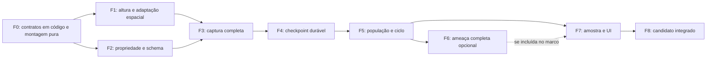

# E07 — pacotes substanciais e fronteiras de execução

18/10/2026. [Contrato v1](e07_contract.md), [decisões](e07/e07_decisions.md),
[inventário factual I0](e07/e07_runtime_inventory.md),
[validação](e07/guides/validation.md). Somente entrega documental nesta rodada.
**Nenhum pacote de runtime está PRONTO ou despachado.**

Base arquitetural: `029b8ca1d7b1752929d549cbeb51e534ea6d3c1d`,
`C:/Users/João Pedro/Documents/ChatGPT/RagRPG`, `codex/playtest`.
SHA-base de implementação, checkout e branch de cada pacote: **A RESOLVER pela
coordenação após integrar o contrato e seus produtores**. Não usar esta base
de leitura como se já contivesse as APIs futuras.

## Propriedade atual e regra de dispatch

Astra possui somente e07_contract.md, este e07_tasks.md, e07/e07_decisions.md,
e07/e07_architecture_checkpoint.md e e07/guides/*.md. Sol I0 possui somente
e07/e07_runtime_inventory.md. Coordenação possui índices globais/e07.md e integração.
Nenhum stage/commit, troca de branch ou nova conversa por estes documentos.

Para promover PLANEJADA → PRONTA, coordenação registra contrato/revisão, decisões
satisfeitas, SHA completo dos produtores integrados, SHA-base, checkout/branch
reais, dono nominal e lista fechada de arquivos, cobertura e resultado esperado.
As fronteiras propostas abaixo não são reservas ativas nem autorização de edição.
Globs novos representam diretórios exclusivos; globs existentes devem ser
expandidos em manifesto de arquivos no dispatch, sem esconder escritores comuns.
Arquivos fora da lista exigem transferência registrada antes da edição.

Todo pacote entrega recibo em `docs/epics/e07/delivery/<id>.md` e seus testes
`tests/e07_<id>_*.gd`/fixtures correspondentes; esses caminhos são futuros.
Arquivos auxiliares `.uid` do próprio script seguem o mesmo dono. `.godot`,
builds, `.tools` e sidecars preexistentes nunca entram automaticamente no commit.
O runner compartilhado tools/verify.ps1 tem um dono por vez: integração registra
os testes em sequência e executa a seleção. Se delegado ao executor, registrar
transferência exclusiva do runner, sem outro escritor paralelo.

## Dependências

F1 e F2 só podem ocorrer em paralelo com arquivos disjuntos, runner serializado
e F0 integrado. Demais produtores/consumidores seguem ordem acima, inclusive
para transferir main.gd/atores/codec. F6 não é dependência de campanha ou geração.
F5 entrega participação mínima necessária a ofertas/trocas/coleta; a tabela completa
de ameaça e sua UI ficam como pacote opcional, dependente de dispatch próprio e
D06. Se F6 entrar no marco, concluir antes do wiring F7 nos mesmos arquivos.
Nunca usar encounter_active=estágio não limpo como substituto de participação.

## F0 — montagem reproduzível e contratos executáveis puros

**PLANEJADA; primeiro pacote preparável após dispatch. Sol / Alto.** Sem decisões
de produto novas: modelar policies obrigatórias e fixtures, sem defaults de
produção, alteração do piloto ou acesso a save. Depende deste contrato integrado.

Resultado: gerar manifesto de fase fixture ramificada com partes/conectores e
superfícies, caminhos testemunha e diagnóstico de falha limitada. Mesma entrada
reproduz mesmo hash. API concreta de GenerationInput, Manifest, WorldPoint,
PartDefinition, PopulationPlan e interfaces de policy fica estabilizada.
Não entregar apenas classes vazias: montagem/validação devem executar em testes.

Arquivos propostos exclusivos: novos `scripts/core/expedition/model/*.gd`,
`scripts/core/expedition/generation/*.gd`, `scripts/data/expedition/*.gd`,
`tests/e07_f0_*.gd`, `tests/fixtures/e07/f0/**`. Nenhum arquivo existente de ator,
main, perfil, catálogo ou UI. Types de policy retornam policy_unresolved quando
ausentes; recipe/parts fixture não viram conteúdo do lobby.

Aceite: I01–I03, entradas ordenadas, colisão de IDs, objetivo inalcançável,
conector estreito/invertido, limite de tentativas e seed adversa. Consumer de
fixture consulta o manifesto, sem mock que simplesmente confirme saída. Entrega
assina signatures/revisões reais; F1/F2 só recebem API após integração.

## F1 — altura funcional e combate espacial coerente

**DECISÃO_PENDENTE D05 + depende F0. Sol / Alto.** Resultado: jogador/AI atravessam
rampa e ponte de prova, selecionam superfície correta e usam a mesma geometria
em ataques/movimento. Amostra técnica, sem expedição persistente liberada.

Arquivos: novos `scripts/core/expedition/spatial/*.gd`,
`scripts/world/expedition_geometry_view.gd`; existentes `scripts/core/arena_navigation.gd`,
`scripts/core/skill_geometry.gd`, `scripts/core/battle_targeting.gd`,
`scripts/actors/*.gd`, `scripts/world/*.gd` afetados e `scripts/main.gd`,
`scenes/main.tscn`; testes F1/fixtures e regressões espaciais enumeradas no dispatch.
Esse conjunto é exclusivo de F1 até integração; não há F3/F6 paralelo nesses arquivos.

Entrega: WorldGeometry.path/sweep/query_attack/resolve_surface e adaptador plano;
registro por skill de regras espaciais/exceções, incluindo teleporte plano E06.
Erro espacial não gasta custo nem executa cast ilegal. Aceite I03–I05/I15,
obstáculos temporários, revalidação de revisão, projétil contínuo, AoE/LoS,
trajetórias de mobilidade e inspeção visual nativa. Não prometer grande escala.

## F2 — bens individuais e evolução segura do schema

**DECISÃO_PENDENTE D01/D02 + depende F0. Sol / Alto.** Resultado: perfil fixture
migra cada exemplar/encaixe uma vez, rejeita uso por alt não dono e mantém unlocks
compartilhados. Wallet mínima e espaço tipado de expedições, sem lojas/consumíveis.

Arquivos: `scripts/core/profile_state.gd`, `character_state.gd`, `profile_codec.gd`,
`profile_store.gd`, `profile_facade.gd`, `build_snapshot.gd`, `run_build_service.gd`,
`run_card_inventory.gd`, `equipment_instance.gd` (todos em scripts/core),
novos `scripts/core/expedition/ownership/*.gd`; testes F2/fixtures e regressões
de perfil/inventário enumeradas. Confirmar caminhos existentes no dispatch.
Não editar character_menu/main nesta tarefa; UI de migração vem em F7 e aplicação
real permanece bloqueada até prévia/decisão do dono do save.

API: MigrationPlan dry-run/validate/apply, CharacterAssets preview/commit e queries
por dono. Aceite I10/I11, posse em snapshot/opções/equip/loot, referências de
presets, migration_required, recuperação, unknowns e retry. Não preencher destino
automaticamente. Validador deve rejeitar migration map incompleto ou fonte alterada.
F4 recebe os arquivos de persistência apenas após F2 integrado.

## F3 — estado congelado completo em memória

**DECISÃO_PENDENTE D02; depende F1/F2. Sol / Alto.** Resultado: capturar/destruir/
reconstruir uma batalha nos mesmos estados sem continuar relógios, rerrolar oferta
ou duplicar efeito. Isso é fundação em fixture, ainda não promessa de save no lobby.

Arquivos: novos `scripts/core/expedition/snapshot/*.gd`; `scripts/core/run_state.gd`,
`effect_proc_ledger.gd`, `combat_event_context.gd`, `health_state.gd` e arquivos
de estados/ledgers de kits enumerados em scripts/core; `scripts/actors/*.gd`,
`scripts/world/*.gd` afetados e main.gd transferidos de F1; RunRewardService em
scripts/core para captura de tickets. Testes F3/fixtures; nenhum ProfileStore paralelo.

API: SnapshotRegistry capture/restore/validate, StableEntityRegistry, barreira de
tick e coverage manifest de runtime_kind. Duas passagens sem callbacks; unknown
kind/reference falha. Aceite I06/I07/I14, dez identidades atuais, ações em voo,
claims secundários, RNG, ofertas e tombstones. Contínuo versus restore compara
próximos resultados, não somente igualdade do JSON. Entrega informa cobertura
exata e tamanho/tempo do snapshot; qualquer kind usado sem adapter bloqueia F4.

## F4 — suspensão e retomada duráveis pelo mesmo writer

**DECISÃO_PENDENTE D02; depende F3 e F2 integrado. Sol / Alto.** Resultado: reabrir
processo restaura último corte durável, sem descartar reward_session como abandono
e sem separar bens de seus eventos. Falha incerta bloqueia até reconciliar.

Arquivos: novos `scripts/core/expedition/persistence/*.gd`,
`scripts/core/expedition/expedition_service.gd`; profile_state/codec/store/facade
transferidos de F2; run_reward_service.gd e main.gd transferidos de F3; testes F4/
fixtures/failpoints. Modelo snapshot é API consumida, mudanças exigem revisão
contratual/transferência, sem fork de serialização.

API: suspend/resume/reconcile e envelope codec com versões reais; registro de
compatibilidade e erro de limite. Aceite I07/I11: crash antes/depois de rename,
ticket emitido/coletado, save futuro, backup, tamanho, requests em conflito e
troca de personagem. Sem save pessoal; sem checkpoint que publique antes do commit.

## F5 — população, portais e ciclo completo de expedição

**DECISÃO_PENDENTE D02/D03/D04/D07 e regra de saída de combate de D06;
depende F4/F0/F1. Sol / Alto.** Resultado:
fase fixture/receita aprovada oferece primeira entrada, limpeza, ida/volta,
ondas globais, morte recuperável e conclusão, com identidade e recibos persistidos.
Não cria catálogo extenso nem economia/quests completas.

Arquivos: novos `scripts/core/expedition/population/*.gd`,
`scripts/core/expedition/campaign/*.gd`, `scripts/world/expedition_portal.gd`;
novo `scripts/core/expedition/combat/combat_participation.gd`;
expedition_service/main/run_reward_service transferidos de F4; mob_occurrence,
mob_catalog, mob_loot_resolver, profile_facade e profile_reward_resolver em
scripts/core se necessários ao adaptador; enemy_actor/player_actor e estados de
morte dos kits transferidos de F3; testes F5/fixtures e tabelas aprovadas em
`data/expedition/policies/**`. Mutação de core do schema exige transferência explícita.

API: enter/travel/record_death/revive/finish, planner e clocks, queries de campanha
para UI. EXP por mob versus etapa depende da decisão D03, não duplicar as duas.
Aceite I06/I08/I09/I12/I13, boss sem respawn, memo obrigatório, zero na penalidade,
retry da onda/morte, slot vivo, estágio não limpo/descarregado, grant único e
quest fixture sem bônus. Não usar limpeza para zerar efeitos/curar como no piloto.
Participação mínima usa vínculos reais de aggro/dano do combate local e o atraso
de saída aprovado em D06. Ofertas/trocas/coleta/regen consultam essa autoridade,
com pausa e snapshot; não exige ledger completo de ameaça nem multiplayer.

## F6 — participação em combate e ameaça controlável

**OPCIONAL, DECISÃO_PENDENTE D06 e dispatch próprio; depende F5/F1/F3.
Sol / Alto.** Resultado: autoridade
individual de ameaça/participação dirigida por eventos reais, com taunt e limiar
aprovados. A ausência de aggro passa a ser distinta de estágio ainda não limpo.

Arquivos: novos `scripts/core/expedition/combat/*.gd` e combat_participation.gd
transferido de F5; enemy_actor/player_actor,
main.gd e integrações de suporte/taunt em scripts/world transferidos após F5;
adapters de snapshot de F3 para serializar novos estados (lista fechada);
testes F6/fixtures. Não editar UI ou criar habilidades de redução novas.

API: ThreatService/CombatParticipation e ThreatView. Aceite replay/empate/cura
efetiva/DoT/pet, taunt/imunidade, leash/ocultação, morte e snapshot. Testar mais de
uma fonte em fixture; sem rede/grupo multiplayer. Atualizar consumidores de
combate (oferta, troca, regen, coleta) para usar participação, preservando os
bloqueios de transação e as exceções de treino/admin contratadas.

## F7 — amostra de conteúdo e UI sobre APIs integradas

**DECISÃO_PENDENTE D07 e demais regras consumidas; depende F5 e F6 somente
se ameaça completa entrar no marco. Terra / Médio.**
Resultado: seleção de fase/retomada, prévia de migração, estado de portais/ameaça
e primeira amostra modular legível. ThreatView só entra com F6 integrado;
sem lógica de gameplay duplicada em UI.

Arquivos: novos `data/expedition/phases/**`, `data/expedition/parts/**`,
`data/expedition/populations/**`, `scenes/expedition/**`, `scripts/ui/expedition/**`;
`scripts/ui/character_menu.gd`, painéis de inventário explicitamente listados,
`scenes/character_menu.tscn` se existente e main.tscn/main.gd para wiring restrito
após transferência de F5 ou F6, conforme marco; testes F7/fixtures.
Arte somente protótipo aprovado D05,
sem catálogo low-poly, runtime kind novo ou nova habilidade.

Aceite: duas montagens diferentes, objetivos/rotas corretos, pt-BR, distinção de
portas locais/viagem/final, informação de retorno, confirmação de migration plan
e erro recuperável. API indisponível bloqueia a tarefa, não autoriza criar sua
própria regra. Se faltar primitiva, Sol recebe delta na tarefa de origem.
Um lote fechado adicional de receitas/textos pode ir a Luna só com API estável,
arquivos exclusivos e ganho concreto; não criar chat de reserva por este plano.

## F8 — candidato, medição e validação consolidada

**PLANEJADA; depende F7 e todos os contratos consumidos resolvidos. Sol / Alto;
Luna / Médio para supervisão do lote automatizado.** Resultado: candidato técnico
com evidências por impacto, amostra medida/exportada e roteiro de playtest humano.
Não é aceite de produto nem autorização de merge.

Arquivos: tools/verify.ps1, probes E07 explicitamente listados, recibos/roteiro e
config de export somente se necessária e sem sobrescrever export local do usuário.
Correções retornam aos donos originais; integração não ganha posse global de
runtime por este pacote. Capturas/logs com hashes e inputs reproduzíveis.

Aceite: matriz completa, limite concreto de escala, nativo e release, regressões
compostas compatíveis, nenhum erro conhecido bloqueante. Preparação/playtest
conforme WORKFLOW após aprovação técnica. Master só após aceite explícito do
candidato testado; sem push. Arquivar executores só após integração validada;
Astra permanente permanece aberto. Não há auditoria Astra automática por fase.

## Registro a preencher na execução

Para cada F0–F8: estado, dono/chat, decisão/revisão, base completa, branch/checkout,
manifesto de arquivos e transferências, API/erros efetivos, hash entregue/integrado,
testes/roles/logs/hashes, limitações e próximo passo. Todos esses campos de
execução estão **não atribuídos** nesta entrega, não aprovados por tabela vazia.
Primeiro passo da coordenação: integrar documentação, resolver base e preparar
F0; encaminhar D01/D02/D05 ao humano para destravar as fundações seguintes.
