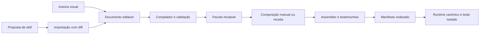

# Arquitetura proposta do editor

Estado e decisões: [índice](README.md). Este documento descreve interfaces futuras;
os nomes propostos não anunciam APIs já disponíveis.

## Autoridades existentes e lacunas verificadas

| Autoridade inspecionada | Reutilização / limite |
|---|---|
| `scripts/data/expedition/part_definition.gd` | Resources de superfícies, conectores, sockets, sólidos e blockers; sem documento editável ou brushes |
| `scripts/core/expedition/generation/input_validator.gd` e `assembler.gd` | Schema fechado, montagem por restrições, tentativas limitadas; não aceita campos livres de editor |
| `scripts/core/expedition/model/generation_input.gd` | Seed textual, revisões, partes, população e grafo; preservar formato canônico |
| `scripts/core/expedition/spatial/world_geometry.gd` | `path`, `position_query`, `sweep`, `resolve_surface`, `query_attack`; autoridade de espaço e revisão |
| `scripts/core/expedition/population/population_planner.gd` | Confere catálogo, regras por slot, suporte e caminho para o corpo do mob |
| `scripts/actors/enemy_actor.gd` | Home/leash, engajamento e retorno; patrulha autorada não foi encontrada nessa interface |
| `data/expedition/phases/ruined_crossing.gd` | Referência real de autoria em código; não é editor nem formato de intercâmbio |
| `scripts/core/content_authoring.gd` | Intercâmbio editorial de textos para outros conteúdos; não compila mapas |

Detalhes contratuais: [F0](../epics/e07/f0_api.md),
[F7](../epics/e07/f7_api.md) e [geometria](../epics/e07/guides/world_geometry.md).
A inspeção é da base registrada no índice; alterações F8 devem ser reconciliadas
antes do dispatch, sem reabrir ou duplicar suas correções.

## Pipeline e limites

1. O documento é a fonte humana, preservando controles, camadas, máscaras e IDs.
2. O compilador produz suporte, colisão/oclusão, apresentação e metadados ligados
   ao mesmo hash de fonte. Navegação continua usando a autoridade do runtime.
3. A composição escolhe versões imutáveis e produz entrada validada do assembler.
4. O jogo consome pacote/manifesto publicados, sem abrir ferramenta de autoria.
5. Estado de patrulha, mortes, loot, RNG e relógios pertence à expedição. Nunca
   gravar esse estado de volta no documento ou no catálogo.

O compilador não duplica fórmulas, não cria outro writer de perfil e não altera
uma expedição existente quando o autor publica uma revisão nova. O limite atual
de snapshot de 4MiB não será aumentado silenciosamente. Se os pacotes não couberem,
bloquear publicação para esse alvo e contratar solução com a autoridade de
persistência; referências externas a conteúdo imutável não estão prontas hoje.

## Modelo de dados proposto

Formato de intercâmbio inicial recomendado: JSON estrito de dados, assets locais
referenciados por ID/hash e manifesto de arquivos. Resources tipados são saída
interna compilada. Não importar scripts/cenas executáveis de bundles externos.

| Documento | Conteúdo mínimo |
|---|---|
| `MapSourceDocument` | schema_version, document_id, revision, unidades, catálogo/revisões, camadas, terreno, objetos, regiões, conectores, sockets e composição |
| `TerrainLayer` | layer_id, domínio horizontal, controles de altura, resolução, máscaras de material, regiões protegidas; superfícies especiais separadas |
| `Placement` | placement_id, definition_id/revision, transformação permitida, superfície/âncora e classificação visual/bloqueante |
| `PopulationBrush` | region_id, preset/revisão, espécie/pesos, quantidade OU densidade, espaçamento, agrupamento, seed, exclusões e slots fixados |
| `PatrolDefinition` | patrol_id/revision, waypoints com superfície, ordem, loop/ping_pong, espera e referências de slots |
| `CompositionDocument` | instâncias, versões, conectores vinculados, regiões fixas, candidatos, grafo de estágios, entradas/portais/objetivos |
| `CompiledMapPackage` | package_id/revision, source_hash, compiler_revision, dependências/hash, partes válidas, dados visuais, relatório e capacidades exigidas |
| `ValidationReport` | código estável, severidade, entity_id, campo, localização/superfície, mensagem pt-BR, reprodução e sugestão |

Congelar o schema exato em M1 com fixtures válidas/inválidas antes de consumidores.
Unidades seguem mundo E07: x/z horizontais e y altura; IDs técnicos em inglês,
texto visível pt-BR. Seed signed64 permanece decimal textual. Proibir NaN/Inf,
duplicatas, referências quebradas e versões desconhecidas. Limitar tamanho,
profundidade e contagem de elementos na leitura; valores serão medidos em M0.

IDs não dependem da ordem do array, NodePath ou memória. Mover objeto mantém ID;
duplicar cria novo ID e remapeia referências internas; excluir aponta dependentes.
Um novo sorteio de brush é operação explícita com diff: slots fixados sobrevivem,
slots regenerados recebem identidade registrada e remoções não são silenciosas.
Migração de fonte cria cópia versionada, com relatório, mantendo o original.

Interfaces propostas: `validate_source`, `compile`, `validate_package`,
`preview_composition`, `export_bundle` e `import_proposal`. Cada resultado contém
`ok`, código, diagnóstico e hashes; falha não publica saída parcial. GUI e entrada
headless chamam as mesmas operações. Exportar draft é permitido e identificado;
publicar exige todas as capacidades e validações do alvo.

## Terreno, navegabilidade e apresentação

Um heightmap único não representa ponte sobre caminho. Cada camada tem seleção
explícita e identificação estável; clique ambíguo oferece seleção de superfície.
Terreno deformado vira triângulos/células convexas coplanares com conexões reais.
Triangular sem ligar células não entrega navegação. Provar suporte contínuo,
inclinação, headroom, raio de travessia e oclusão na mesma geometria.

Malha visual e lógica podem ter resoluções distintas, com tolerância declarada
e teste de concordância, especialmente em bordas, rampas e paredes. Nunca usar
suavização visual que faça o ator parecer atravessar o chão. Presets de corpos
mostram passagem possível para jogador e mobs de raios diferentes.

Brushes: elevar, baixar, nivelar por amostra/valor, suavizar, pintar material,
rampa/caminho por pontos de controle e largura; círculo/quadrado primeiro,
elipse/máscara depois. Raio, intensidade, dureza e falloff independentes. Traço
amostrado por distância/tempo definido, sem efeito dependente do FPS. Undo de um
traço é atômico. Conectores/bordas/caminhos protegidos não sofrem suavização cega.

“Andável” é restrição de autoria submetida à validação: pintar não torna penhasco
transponível. “Bloqueado” distingue corpo, ataque/LoS e simples decoração, usando
somente capacidades reais. Não prometer máscaras que o runtime não representa.
Path de intenção é guia de terreno/rota; path calculado é resultado geométrico;
patrulha é comportamento de ator. A UI precisa distingui-los.

Materiais têm miniatura, escala/rotação, transições e paleta por bioma. UV/blend
dependem de D2. Props usam catálogo autorizado, assentamento, inclinação máxima,
transformações permitidas e collider declarado. Scatter evita entradas,
conectores, rotas protegidas e encontros; detalhes de folhas não ganham colisores.
Biblioteca mostra licenças/origem, dependências e ausências de assets no export.

## Composição manual e WFC

O modo manual fixa instâncias e conexões; presets de regiões inteiras permitem
handmade completo. O F0 atual escolhe candidatos/rotações numa árvore de peças:
isso não é uma API de posicionamento arbitrário, ciclos locais ou pins de rotação.
M3 deve explicitar um adaptador compatível ou um delta versionado. O editor
nunca simula suporte a placement fixo deixando o assembler rerrolá-lo.

Conectores mantêm tipo, tags, sentido, normal, largura e altura. Rotação só nas
opções permitidas; espelho/escala/offset vertical não são reparos automáticos.
Blend visual de emenda não pode fechar a passagem útil ou mudar a colisão.

WFC é opção de solver para restrições locais, com propagação de candidatos e
escolha de baixa entropia; pode chegar a contradições. Referência primária:
[WaveFunctionCollapse](https://github.com/mxgmn/WaveFunctionCollapse).
Para RagRPG, a proposta é manter grafo/obrigações primeiro e validar globalmente
o resultado. Compatibilidade local não prova que boss, saída e quests são alcançáveis.

M6 compara o assembler existente com solver opcional em corpus idêntico. Define
domínio (slots/grafo ou grade), pesos, regras de adjacência, pins, restrições de
quantidade e diversidade. Layout, decoração e população têm streams independentes.
Empates/enumeração são determinísticos; orçamento global limita propagação,
backtracking e reinícios. Cancelar não publica. Erro identifica região/pin/regra,
seed, revisões e consumo do budget; não relaxa restrições nem troca por mapa fixo.
Preservar regiões fixadas, permitir regenerar seleção, mostrar antes/depois.
Mudança de algoritmo exige revisão nova; mundo existente usa manifesto realizado.

## População e patrulhas

Pincéis dispersos usam distância mínima; concentrados usam centros de grupo,
raio e variação controlada. Quantidade exata e densidade são modos distintos.
Sem espaço suficiente, mostrar déficit/causa; não reduzir uma quota obrigatória
silenciosamente. Densidade usa área navegável da camada selecionada, descontando
exclusões; política de arredondamento e ordem estável ficam no schema M4.

Espécies/pesos, bioma/origem, categorias, home, blocks_clear e referências de
respawn/recompensa vêm dos catálogos/policies existentes. Validar corpo real,
rota, distância da entrada e palco de memorável. Separar população total de
atores ativos; editor não introduz streaming de simulação por conta própria.
Marcadores de NPC sem consumidor ficam não publicáveis como comportamento.

Patrulha requer implementação real M5. Cada segmento passa por WorldGeometry
com perfil do mob; não usar interpolação reta entre pontos atravessando paredes.
Proposta D5: idle → patrol/wait; aggro interrompe; retorno respeita home/leash
existente e retoma waypoint legal. Rota precisa caber no leash fixo. Obstáculo
temporário invalida rota; tentar recalcular com orçamento, aguardar e diagnosticar
se bloqueada, sem teleporte. Rotas entre estágios ficam fora do primeiro escopo.

Persistir waypoint, direção, espera restante e estado necessário à continuidade;
pausa/suspensão congelam, estágio sem jogador segue política vigente. Contratar
restart após respawn usando slot/geração sem duplicar vivo ou recompensa. Testar
morte em espera, aggro no meio da rampa, retorno bloqueado e retomada de processo.
Não ampliar codec ou grafo persistente sem invariantes e dono explícito.

## Interações, interface e recuperação

Primeiro subset: sockets de entrada, portal de viagem, objetivo/saída/refúgio
existentes. Condições e concessões continuam no serviço canônico; a tela apenas
parametriza referências válidas. Futuro trigger tipado precisa de contrato de
eventos, filtros, reentrada e idempotência; campo de GDScript arbitrário excluído.

Viewport central, paleta, inspector contextual, árvore de camadas/objetos,
busca e problemas clicáveis. Overlays de suporte/altura, bloqueio, LoS, folga,
conectores, população e rotas. Operações mínimas: selecionar, mover, duplicar,
agrupar, ocultar/travar camada, snap, desfazer/refazer, salvar e testar.
Não depender só de cores para erro/estado. Atalhos e foco de teclado previsíveis.

Rascunho pode estar inválido. Autosave recuperável separado do publicado;
gravação temporária + troca atômica, backup e detecção de arquivo alterado fora
do editor. Falha de disco/fechamento não substitui a última versão íntegra.
Compilar tem progresso/cancelamento, invalidação por região e descarte de retorno
obsoleto se o documento mudou. Preview leve durante o traço; validação completa
antes de publicação. Cache chaveado por fonte/compilador/dependências/perfil;
cache ausente ou corrompido reconstrói, não muda resultado.

Teste rápido usa o pacote compilado real, seed registrada e perfil descartável;
retornar preserva o rascunho. Publicação local gera revisão imutável e relatório;
não significa merge, push ou migração de save. Mudança de revisão de conteúdo
não reescreve expedições antigas: carregar versão compatível ou erro explícito.

## Intercâmbio e skills

Bundle: fonte, manifesto de hashes/dependências, schema/compilador, seed/corpus,
assets permitidos, relatório, miniatura e brief humano. Sem caminhos absolutos
da máquina, secrets ou saves. Resolver arquivos dentro da raiz do bundle,
rejeitar path traversal, links externos inesperados e conteúdo executável.

Proposta delegada declara base_hash, IDs permitidos, áreas bloqueadas, operações
permitidas, budgets e critérios. Importar em clone, conferir base, mostrar diff
semântico e preview, validar e só então aplicar como uma ação desfazível.
Base divergente pede reconciliação explícita; não sobrescrever autoria humana.
Idêntica entrada na GUI ou headless deve gerar hash compilado idêntico.

Depois de APIs estáveis, M7 adapta fontes versionadas de `ragrpg-mapdelivery`,
`ragrpg-enemydelivery` e `ragrpg-art`: respectivamente composição/terreno,
população/patrulhas e materiais/props. Criar skill específica de editor apenas
se o fluxo não couber claramente nessas três. Nenhuma skill calcula loot, muda
política ou publica automaticamente. Sincronização instalada segue procedimento
de skills; este planejamento não altera as cópias instaladas.

Hospedagem recomendada usa APIs internas do Godot, cuja documentação permite
plugins em GDScript/cenas: [Making plugins](https://docs.godotengine.org/en/stable/tutorials/plugins/editor/making_plugins.html).
Isso não comprova compatibilidade de cada chamada com o executável 4.7.2;
M0 verifica lifecycle, histórico e dependências `@tool` antes de implementar.
