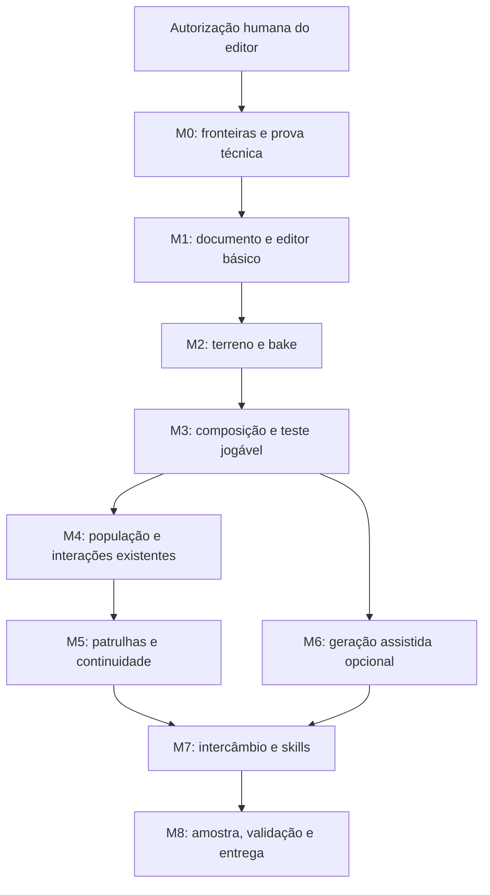

# Pacotes e chats preparados

**Retomada vigente de 4/11:** F9 integrada em master, F10 ativa e Q5 autorizado.
Base, propriedade, resultados e próximos passos no [checkpoint F10](delivery/f10.md)
e no [contrato Q5](contracts/f10_q5_review.md). Reutilizar o worktree/fixture atuais
conforme STORAGE. As reservas e branches nas seções seguintes são históricas.

## Histórico dos pacotes preparados

**F9 em execução25/10/2026**, autorização humana neste chat; [dispatch nominal](contracts/f9_dispatch.md)
e [rastreabilidade](f9_requirements.md). Reserva F9 abaixo substituída somente
nesse ponto. F10 não foi iniciado.

## Extensão de fechamento F9/F10 — pedido humano25/10/2026

[F9](contracts/f9_completion.md) implementa os pendentes F0–F8 em uma matriz
exaustiva de completude; [F10](contracts/f10_final_review.md) faz revisão,
reprodução e fechamento integrados sobre a entrega F9. Ambos são reservas,
sem autorização de execução por criação do chat. F10 não começa automaticamente
quando F9 terminar. São nomes novos solicitados pelo humano; M0–M8 abaixo
continuam sendo a nomenclatura histórica dos produtores, sem épico novo.

Propriedade/runtime/base/branches nominais serão resolvidos na ativação e
transferidos sequencialmente, usando apenas o worktree atual. O critério do
fechamento é satisfazer os requisitos do editor, sem reclassificar faltas como
opcionais/futuras; produto realmente novo exige decisão própria. Não abre E08+.

**Regra humana25/10/2026:** manter somente o checkout principal e um worktree
atual; reutilizar uma fixture e remover artefatos antigos de teste/build.
Todo próximo pacote deve seguir [armazenamento e limpeza](STORAGE.md).
As instruções históricas abaixo não autorizam acumular checkouts/cópias.

**Atualização humana24/10/2026:** o encerramento/teste/integração de E07 não
bloqueia mais o editor. F0/M0 está autorizado a continuar; D1 (tela própria no
Godot) e D3 (grade por camada com pontes/rampas especiais) aprovadas. D2 deve
preceder o bake visual M2; D4, o aceite M2. Provas de funcionalidades ainda
inexistentes ficam com seus produtores M1/M2, sem exigir o teste da amostra E07.
Ver [registro vigente](delivery/m0.md). Não é aprovação automática de F1/M1.

23/10/2026. [Proposta](README.md), [contratos](architecture.md),
[provas](validation.md). Todos os pacotes estão **PLANEJADOS**, sem chat criado,
sem reserva de runtime e sem nova autorização de épico. “Engatilhados” significa
prompts e sequência preparados para despacho após as decisões/dependências.
O pedido posterior nesta conversa mantém as correções exclusivamente com F8.

## Sequência e propriedade

Complemento humano24/10: [composição e emendas por bioma](contracts/map_composition_and_seams.md).
M2 representa bordas/aberturas no bake; M3 entrega mapas completos customizados
com vínculos escolhidos pelo usuário e barreiras legíveis; M6 acrescenta geração
algorítmica/assistida respeitando regiões fixadas. WFC não substitui validação
global nem é requisito do modo manual. M1 preserva a fronteira documental para
essa composição, sem antecipar solver ou catálogo de barreiras.

M6 pode ser dispensado explicitamente para entregar editor sem WFC; M7 então
declara a capacidade ausente. Não confundir dependência com obrigação de ampliar
o MVP. O editor não aguarda correção da amostra F8. Cada prova resolve base
explícita e valida a autoridade necessária com fixture própria, sem assumir
que bugs conhecidos desapareceram e sem tomar a propriedade de correções F8.
Padrão inicial sequencial. Paralelizar M5/M6 somente após contratos estáveis e
manifestos de arquivos sem sobreposição; a vantagem precisa ser concreta.

| Pacote / modelo proposto | Resultado verificável | Dependências | Dono de arquivos proposto |
|---|---|---|---|
| M0 — Sol, médio | Inventário atualizado, fronteira com F8, schema/API detalhados, spike de hospedagem; D1/D3 aprovadas, D2/D4 encaminhadas com prazos e medição por produtor | Liberação do marco; base explícita e isolamento da prova, sem gate de fechamento E07 | `docs/map_editor/contracts/`, `tools/map_editor_probe/` |
| M1 — Sol, médio | Fonte tipada/versionada, validação básica, salvar/reabrir/recuperar, undo/redo, shell pt-BR e operações headless | M0 e D1/D3 | `scripts/map_authoring/document/`, `scripts/map_authoring/io/`, `addons/ragrpg_map_editor/`, testes `map_editor_document_*` |
| M2 — Sol, alto | Brushes e compilador: uma peça com platô/rampa, camadas/ponte, dois materiais, suporte/oclusão coerentes | M1, D2/D4 e API de geometria estável | `scripts/map_authoring/terrain/`, `scripts/map_authoring/compiler/`, UI transferida de M1, testes `map_editor_terrain_*` |
| M3 — Sol, médio | Manual/receita: duas peças, emenda, conectores, mapa fixado, diagnóstico, teste isolado e publicação local | M2 | `scripts/map_authoring/composition/`, `scripts/map_authoring/preview/`, UI transferida, testes `map_editor_composition_*` |
| M4 — Sol, médio | Brushes disperso/concentrado, slots fixos, catálogo, exclusões e interações já existentes | M3 | `scripts/map_authoring/population/`, UI transferida, testes `map_editor_population_*` |
| M5 — Sol, alto | Patrulha executável, interrupção/retorno, bloqueio, pausa/respawn e continuidade durável | M4 e D5 | `scripts/map_authoring/patrol/`, nova implementação runtime de patrulha, arquivos críticos nominais após inventário; testes `map_editor_patrol_*` |
| M6 — Sol, médio | Comparação de solver atual/WFC, pins, seeds, contradições, limites e regeneração parcial | M3 e D6 | `scripts/map_authoring/generation/`, testes `map_editor_generation_*`; UI apenas por transferência |
| M7 — Sol, médio | Bundle seguro, importação com diff, fonte CLI/GUI equivalente, fluxo de skills documentado | M4/M5 e decisão de incluir ou adiar M6 | `scripts/map_authoring/exchange/`, `skills/ragrpg-mapdelivery/`, `skills/ragrpg-enemydelivery/`, `skills/ragrpg-art/`, testes `map_editor_exchange_*` |
| M8 — Sol, médio | Candidato integrado e área representativa, export release, evidências e roteiro humano | Capacidades incluídas entregues | `docs/map_editor/delivery/`, fixtures de amostra sob `data/map_authoring/`; integração nominal |
| L — Luna, baixo | Supervisão da seleção de testes de cada candidato e lotes de fixtures sobre API estável | Executor fornece SHA, comando/seleção e manifesto | Só relatório/logs de supervisão; fixtures apenas se concedidas nominalmente |

Esses caminhos são **propostos**, não diretórios existentes nem autorização de
escrita ampla. Cada dispatch resolve lista nominal de arquivos, inclusive `.uid`,
cenas, testes e documentação. Cada pacote escreve seu recibo em
`docs/map_editor/delivery/mN.md`. UI compartilhada muda de dono em registro;
o anterior encerra escrita antes do próximo. `tools/verify.ps1`, `project.godot`,
runtime de geometria, atores, codecs e catálogo não têm dono implícito por tabela:
precisam de transferência nominal e escopo no dispatch. Não há escritor simultâneo
com F8. Se D1 escolher aplicativo dedicado, revisar os caminhos de UI antes de M1.

## Conclusão de cada pacote

- M0 entrega D1/D3 aprovadas, schema com exemplos, API/error codes, protocolo de
  medição e prova de hospedagem do Godot local. D2/D4 ficam explicitamente
  pendentes de suas provas M2, sem bloquear o shell M1. Não declarar medidas de
  brush/bake inexistentes como concluídas. Escolha pendente bloqueia apenas seu
  consumidor; não libera renderer implícito nem dispensa invariantes de runtime.
- M1 prova roundtrip sem perda, recuperação após interrupção, desfazer/refazer,
  IDs/referências e rejeição sem mutação. UI básica já precisa funcionar.
- M2 percorre subida e passagem inferior, testa oclusão e brush determinístico;
  geometria visual/lógica concorda no erro contratado. Reabertura preserva fonte.
- M3 realiza composição fixa sem mudanças ocultas, variantes autorizadas,
  caminhos testemunha e falhas localizadas; teste usa pacote exportado real.
- M4 preserva slots fixos, reporta déficit e valida corpo/rota/limpeza. Retorno,
  respawn e grants usam as autoridades de E07 sem comportamento paralelo.
- M5 preserva patrulha num restart real, com casos de aggro/bloqueio/morte;
  alteração persistente tem compatibilidade explícita e invariantes.
- M6 entrega relatório comparativo e escolha justificada. Solver pior/inadequado
  pode permanecer experimental desabilitado; não esconder falha como sucesso.
- M7 prova mesma saída entre GUI/headless, base divergente, diff, importação
  idempotente e rejeição de bundle inválido; skill segue contrato executável.
- M8 permite ao usuário cumprir o fluxo completo sem código, mede limites e
  entrega candidato tecnicamente validado com roteiro para aceite humano.

## Preparação concreta do dispatch

O chat solicitante ou executor operacional explicitamente designado faz a
preparação. Não atribuir gerência contínua ao chat de arquitetura.

1. Confirmar autorização do pacote e decisões aplicáveis; registrar no índice
   do épico ao qual o usuário vincular o editor, sem inventar E08.
2. Resolver SHA completo da composição atual, estado de F8, APIs entregues e
   trabalho local. Base desta análise não substitui base executável.
3. Preparar branch `codex/map-editor-mN` e checkout isolado apropriado; registrar
   caminho real e SHA. Preservar o diretório fixo, imports e save pessoal.
4. Gravar manifesto nominal de arquivos e transferências; resolver conflito
   de propriedade antes de abrir escritor. Branch isolada não resolve isso.
5. Gravar dispatch com prompt abaixo preenchido, contrato/revisão, resultado,
   exclusões, limites de runtime e testes positivos/negativos/integrados.
6. Criar somente o chat desbloqueado, usando o projeto correto e modelo/esforço
   propostos; registrar ID e link no dispatch. Não abrir consumidores em espera.
7. Executor implementa e corrige; Luna supervisiona checks; Sol valida contrato.
   Registro do pacote contém SHA entregue/integrado, logs/hashes e limitações.
8. Integrar por dependência. Playtest segue aprovação técnica e WORKFLOW;
   master exige aceite explícito do candidato. Sem push automático. Arquivar
   apenas entrega validada e integrada, mantendo chat para correções pendentes.

## Prompts prontos para preencher

Os campos entre chaves precisam de valores reais antes do envio. Estes textos
são handoffs de trabalho; não são autorização retroativa ou comandos agendados.

### M0 — Editor de mapas: fechar fronteira executável

> Execute somente M0 do plano docs/map_editor/execution.md, autorizado em
> {referência humana}. Modelo Sol, esforço médio. Base {SHA completo}, branch
> {branch}, checkout {caminho real}; manifesto exclusivo {arquivo}. Leia AGENTS,
> WORKFLOW, MVP, ARCHITECTURE e os três documentos do editor. Reconcile as APIs
> entregues por F8 sem corrigir performance/rampa: essa tarefa pertence ao chat
> F8. Feche contratos concretos de documento/compilação/hospedagem e apresente
> deltas D1–D4 ainda não decididos antes dos consumidores. Faça apenas o spike
> autorizado, sem engine de editor completa ou conversão de renderer implícita.
> Entregue medições, erros/limites, lista de arquivos e checkpoint M0. Não abra
> M1 nem outros chats por inferência.

### Executor M1–M7 — Editor de mapas: {pacote e resultado}

> Execute {M1…M7}, autorizado em {referência}, usando Sol/{esforço da tabela}.
> Base {SHA}, branch {branch}, checkout {caminho}, contrato {revisão/hash},
> manifesto de escrita {arquivo}, dependências integradas {SHAs}. Leia o fluxo
> vigente, docs/map_editor e recibos produtores. Entregue exatamente {resultado
> e critérios da linha}, excluindo {exclusões concretas}. APIs disponíveis:
> {nomes/versões}. Decisões humanas aplicáveis: {IDs/respostas}. Não altere
> arquivos de F8 ou fronteiras não transferidas. GUI, headless e runtime devem
> consumir a mesma autoridade. Acrescente invariantes às regras novas; liste
> tools/verify.ps1 antes de selecionar checks por impacto, passe seleção/SHA
> para Luna e corrija falhas sem relaxar expectativas. Faça inspeção nativa
> se visual. Entregue código, recibo, hashes/logs, limites e próximo passo;
> não inicie pacote posterior, não publique externamente e não use save pessoal.

### Luna — Editor de mapas: supervisão automatizada

> Supervise a seleção {IDs/comando exato} autorizada por Sol para {pacote},
> checkout {caminho}, SHA {completo}, Godot {versão/hash}, fixture {diretório}.
> Registre início/fim, conclusão real, saída, SCRIPT ERROR, timeout, logs e
> hashes. Exit 0 sozinho não prova PASS. Não edite runtime, runner ou oráculos.
> Reporte falha/reprodução a Sol na coordenação autorizada. Após correção,
> execute somente seleção revisada pertinente, distinguindo evidência nova
> da reaproveitada. Entregue relatório em {caminho exclusivo}.

### M8 — Editor de mapas: integração e candidato

> Integre apenas {pacotes/SHAs aprovados} no checkout {caminho}, branch {branch},
> base {SHA}, conforme manifesto {arquivo}. Modelo Sol, esforço médio. Confira
> proprietários, APIs e decisões antes da composição. Conflitos/rebase exigem
> revalidação por impacto com Luna. Produza a área representativa de
> docs/map_editor/validation.md, export release e roteiro humano; diferencie
> prova funcional, visual e medição. Atualize playtest somente após aprovação
> técnica do conteúdo exato e conforme WORKFLOW. Não migre save pessoal, não
> faça merge master/push sem autorização própria. Registre hashes integrados,
> limitações, capacidades adiadas e estado de cada pacote.
